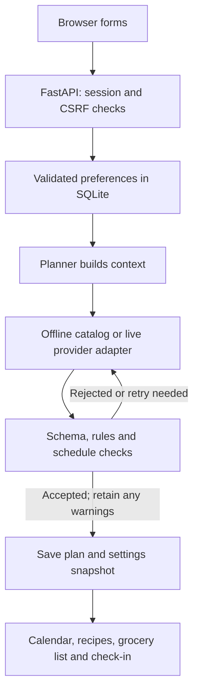

# PlateJoy Red-Team Playbook

**For:** Abel, Ethan, Kunaal and Navraj · **Project:** PlateJoy Beta · **Branch:** `KS_Work`  
**Prepared:** November 12, 2026 · Commands below use **Windows Git Bash**, from the repository root.

> **Dates:** Your assignment specifies **November 12: review PDF due before class ends** and **November 17: response due before class ends**. Use those dates and your class schedule rather than interpreting “tomorrow” as a different deadline. The partner-team review and required submissions are in-class activities. This is a preparation guide, not a completed review of the other team.

Attendance is required for credit; the assignment is worth 7% of the course grade.

**During class:** keep Sections 1, 4 and 5 open. Use the remaining sections as reference and copy only the required report/response templates for submission.

## Jump to what you need

1. [Start here: the quick sheet](#1-start-here-the-quick-sheet)
2. [Roles and class timing](#2-roles-and-class-timing)
3. [Explain our architecture](#3-explain-our-architecture)
4. [Our 12-minute author walkthrough](#4-our-12-minute-author-walkthrough)
5. [Copy-and-paste command bank](#5-copy-and-paste-command-bank)
6. [Ready answers to likely questions](#6-ready-answers-to-likely-questions)
7. [Story-to-test evidence map](#7-story-to-test-evidence-map)
8. [Known risks: be ready to discuss them](#8-known-risks-be-ready-to-discuss-them)
9. [How to review the other team](#9-how-to-review-the-other-team)
10. [Bounded prompts to use with an LLM](#10-bounded-prompts-to-use-with-an-llm)
11. [One-page understanding template](#11-one-page-understanding-template)
12. [Two-page review template](#12-two-page-review-template)
13. [Incoming findings and response plan](#13-incoming-findings-and-response-plan)
14. [Two-minute presentation](#14-two-minute-presentation)
15. [Submission and evidence checklist](#15-submission-and-evidence-checklist)

---

## 1. Start here: the quick sheet

### What to have open

- PlateJoy already running at <http://127.0.0.1:8000>.
- A disposable review account and an existing plan. Avoid showing personal accounts.
- [Our GitHub branch](https://github.com/ethanKlose/CS4501-Startup-0-elbaum/tree/KS_Work), [issues](https://github.com/ethanKlose/CS4501-Startup-0-elbaum/issues), this guide, and a terminal.
- `app/services/planner.py`, `app/services/validators.py`, `app/routers/survey.py`, `app/routers/kroger.py`, and `tests/integration/`.
- `docs/evidence/beta-planning/validation.json` and `docs/acceptance/`.

### Our short introduction

> “PlateJoy helps students build a week of meals around budget, diet, nutrition goals and cooking availability. The generator selects meals; application code validates the result before saving it. We also consolidate groceries, track purchases and cooking, and offer Google Calendar and Kroger connections.”

### Five answers everyone should know

1. **What is enforced?** Structure, encoded diet/kitchen rules, estimated budget and other hard checks reject a plan. Nutrition and cooking-capacity misses can remain as visible warnings after the final attempt. Cooking deadlines are hard checks.
2. **Are the tests real?** Yes: real application logic, HTTP requests, database transactions and rendered responses are tested. External provider responses are controlled in automated tests. That does not establish live AI quality or retailer availability.
3. **What passed?** The preparation rerun passed **771 Python cases**, including **157 integration cases**, plus **24 separate JavaScript DOM cases**. Do not add the 157 to 771; they are included.
4. **What is not established?** Fresh native-browser acceptance of the latest Beta screens, formally executed manual procedures, representative live-provider quality, human time savings/preference, and production-load behavior.
5. **What if something fails?** Reproduce it, record the actual result and affected commit, explain the risk, and propose a testable fix. A failed check is useful evidence, not something to hide.

### Capture the version and check the running app

Run each command separately:

```bash
git branch --show-current
```

```bash
git rev-parse HEAD
```

```bash
git status --short
```

```bash
curl --max-time 5 -i http://127.0.0.1:8000/health
```

Expected: `KS_Work`, a commit identifier, understood local changes, and HTTP 200 with `{"status":"ok"}`. Record any local changes: a commit ID alone does not describe an uncommitted working tree.

**Do not pull, switch branches, install packages, or modify code during the timed review unless needed and agreed with the authors.** Preserve the exact environment being reviewed. Never display `.env`, tokens, real passwords, or private session cookies.

---

## 2. Roles and class timing

Suggested assignments; swap based on who is most comfortable:

| Person | Suggested role | Responsibility |
| --- | --- | --- |
| Kunaal | Technical author | Architecture, validators, tests, failure recovery |
| Ethan | Product author | User stories, running-app walkthrough, expected behavior |
| Abel | Outbound learner / reviewer | Learn the partner app, choose two critical flows, verify findings |
| Navraj | Recorder / timekeeper | Help the outbound reviewer capture evidence and produce the report |

The assignment requires **one learner and two authors in each parallel subgroup**. The fourth teammate can assist with recording; the exact arrangement follows the instructor's pairing.

| Phase | Time | Output |
| --- | ---: | --- |
| Pairing and access | 3 min | Repository read access and an already-running app |
| Parallel deep dives | 12 min | Questions, story/architecture notes, test commands |
| Learner summary + author confirmation | 10 min | Accurate one-page Markdown understanding |
| Test-suite check | 3 min | One test run; record command, version and result |
| Story-to-test mapping | 6 min | Which critical acceptance criteria have evidence or gaps |
| Two critical-flow inspections | 6 min | Verified route/logic findings |
| Top-three report | 10 min | Maximum two-page review, exported to PDF |
| Incoming-report analysis | 10 min | Probability and business impact for every finding |
| Response planning | 10 min | Owners, actions, effort, acceptance tests and residual risks |
| Lightning presentation | 2 min/team | Biggest finding and concrete remediation plan |

The instructor schedules the presentation block and the two class sessions. Keep the **review PDF** and **response plan** as distinct submissions.

---

## 3. Explain our architecture

### A simple explanation

> “The browser sends forms to a Python FastAPI server. The server validates input, uses SQLAlchemy to save each student's state in SQLite, and renders Jinja HTML pages. The planner builds a context from the student's settings. Without a key it uses an offline recipe catalog. With a configured key, the live adapter asks for approved recipe selections and the server supplies trusted recipe details. Validators and the scheduler check the result before it is committed.”



The retry loop is bounded. A hard failure is not saved as a valid plan. A final-attempt soft miss may be saved with warnings. Database access also occurs throughout normal routes; the diagram describes the main planning path.

### Where to point in the repository

| Component | File | Explain it in one sentence |
| --- | --- | --- |
| App wiring and startup migrations | `app/main.py`, `app/db.py`, `migrations/` | Middleware and routes are wired here; startup upgrades the schema. |
| Login and per-user access | `app/deps.py`, `app/routers/auth.py`, `app/security.py` | A signed session identifies the user; owned resources are checked by routes. |
| CSRF and quotas | `app/web_security.py`, `app/rate_limits.py` | Mutations require a session-bound token and are rate limited. |
| Planning inputs | `app/routers/survey.py`, `app/services/nutrition_goals.py` | Validate amounts and selections; save the unified form transactionally. |
| Frontend controls | `app/templates/survey.html`, `app/static/planning.css`, `app/static/app.js` | Four sections, aligned choices, slider/number synchronization and validation navigation. |
| Planning orchestration | `app/services/planner.py` | Build context, ask, validate, retry, save, and roll back failed requests. |
| Provider boundary | `app/services/llm.py` | Offline generation or live approved-catalog selections; hydrate trusted recipe data. |
| Rules and structure | `app/services/schema.py`, `app/services/validators.py`, `app/services/diet.py` | Reject malformed or hard-rule-breaking output; expose soft misses. |
| Cooking and grocery calculation | `app/services/schedule.py`, `app/services/pricing.py`, `app/services/inventory.py` | Schedule prep, estimate whole-package costs and maintain the purchase/consumption ledger. |
| Calendar sync | `app/routers/integrations.py`, `app/services/google_calendar.py` | Consent, encrypted tokens and reconciliation of application-owned events. |
| Shopping handoff | `app/routers/kroger.py`, `app/services/kroger.py` | Search, choose, review and explicitly confirm a cart addition. No checkout. |

### Two flows to know especially well

**Flow A — generate/regenerate:** authenticated request → user write lock → settle previous inventory inside the transaction → build context → generator → schema/hard/soft checks → retries → settings/meal snapshot → commit. `PlanFailed` causes the route to roll back, preserving the previous committed plan and ledger. A swap rechecks the whole resulting plan, not just the new meal.

**Flow B — Kroger cart:** OAuth → store → unchecked, pantry-adjusted ingredients → explicit product/package selection → server review token → confirmation → durable `sending` marker committed **before** the external cart write → sent/rejected/uncertain receipt. An ambiguous outcome stays blocked until the user checks the actual cart and acknowledges it. This prevents automatic blind retries; it does not promise exactly-once processing by Kroger.

---

## 4. Our 12-minute author walkthrough

Use the existing review account and plan. Live generation and saving nonempty preference notes can use provider tokens; do repeated experiments in the offline practice environment in Section 5.

| Minute | Show | What to say |
| --- | --- | --- |
| 0–1 | Product and story groups | “Our main loop is preferences → verified plan → groceries → check-in → next week.” |
| 1–3 | `/survey`, Budget & goals | Select protein and calories together. Type 137g, then move the slider. “These are separate saved targets, not just visual controls.” |
| 3–4 | Your week and Your kitchen | Show aligned meal choices, a meal marked Elsewhere, available equipment and expandable timing. “Outside meals are excluded from recipes and grocery calculations.” |
| 4–6 | Existing plan and `planner.py` | Show a recipe, costs and the checks panel. Explain hard rejection versus soft warnings. |
| 6–7 | Grocery list and pantry | Show consolidated ingredients and a checked item. “A cart addition is not a purchase confirmation.” |
| 7–9 | `tests/integration/` and terminal | Show the full-suite result and one targeted test. Point out actual HTTP, database and provider boundaries. |
| 9–10 | Connected apps / Kroger review | If configured, show product review. Stop before a real transfer unless explicitly intended. Explain uncertainty handling using the automated test. |
| 10–11 | State, auth and security | Show ownership and CSRF tests; explain rollback and session revocation. |
| 11–12 | Known limits and questions | Admit missing evidence, describe the two known hardening opportunities in Section 8, invite their two-flow focus. |

### Specific demonstrations

**Both goals and persistence**

1. In Preferences → Budget & goals, select Protein and Calories.
2. Set protein to **137g**, confirm the slider follows, then move it and confirm the number follows.
3. Set calories to **2200**. Save and reload; both stay selected.
4. Clear only protein; calories should remain selected after saving.
5. Explain: protein is a daily minimum; calories use the displayed tolerances. The planner may report unmet goals. Do not promise these particular targets are feasible for every diet/budget.

**Input validation**

- Try **301g** protein or **29.99** budget. The browser should prevent progression/save and reveal the field.
- Then point to the HTTP tests to demonstrate server enforcement even if HTML restrictions are bypassed.
- Selecting a valid **$30** budget does **not** guarantee a feasible plan exists at that budget.

**Meals elsewhere**

- Mark Wednesday lunch Elsewhere, save, and generate in the offline demo if time allows.
- For a complete future week with no other omissions, 21 meal slots become 20. Today-mode, skipped days or other outside meals change that count.
- Show the nutrition warning: outside meals are not included in full-day nutrition verification.

**Failure and recovery**

Run the provider-failure test instead of deliberately breaking a real key. Explain that it verifies old plan/inventory preservation, not live provider uptime.

**Kroger and Google**

Show local connection status and existing results. Use controlled tests to demonstrate double-submit, timeout and partial-sync behavior. Do not add real cart items, erase calendar entries or repeatedly reconnect accounts merely to make the demo look active.

---

## 5. Copy-and-paste command bank

**Use our repository root.** For Kunaal's machine:

```bash
cd ~/OneDrive/Desktop/KS_LLM
```

A teammate should use their own clone path. Commands contain no trailing `&&` and require no virtual-environment activation.

### A. Start the existing local application, if it is not running

```bash
.venv/Scripts/python.exe -m uvicorn app.main:app --host 127.0.0.1 --port 8000 --no-access-log
```

Keep this terminal open. Use another terminal for tests. During the partner-team review, use their provided running environment rather than rebuilding it.

### B. Optional offline practice server: no OpenAI or Anthropic calls

Run this in a separate terminal. It overrides keys for this process only and uses a separate demo database:

```bash
OPENAI_API_KEY= ANTHROPIC_API_KEY= DATABASE_URL=sqlite:///./red_team_demo.db .venv/Scripts/python.exe -m uvicorn app.main:app --host 127.0.0.1 --port 8001 --no-access-log
```

Open <http://127.0.0.1:8001>, create a disposable account and use Demo mode. This does not modify `.env` or the normal `platejoy.db`. Do not use this second server for real Google/Kroger OAuth: the registered callbacks use port 8000. Stop it with Ctrl+C when finished.

### C. Run the complete Python suite once

```bash
.venv/Scripts/python.exe -m pytest -q --junitxml=test-results/red-team-full.xml
```

**Preparation result:** 771 passed, 0 failed, 1107 warnings, **126.89 seconds** on the preparation host, without coverage instrumentation. Your machine can take longer. Start immediately in the three-minute test window. If it is still running at the cutoff, record “running” and collect the eventual result while continuing the audit; never invent a pass.

The default `pytest.ini` selects `tests/`. Paid `live_tests/` and `live_integrations/` are separate opt-in suites. `tests/conftest.py` blanks provider keys. Deprecation warnings are distinct from failed tests.

### D. Fast, targeted proof commands — choose the relevant one

**Combined nutrition goals and unified save/rollback:**

```bash
.venv/Scripts/python.exe -m pytest -q tests/integration/test_beta_preferences.py
```

**Boundary values, custom protein and both goals:**

```bash
.venv/Scripts/python.exe -m pytest -q tests/test_beta_nutrition.py
```

**Provider failures preserve the old plan and inventory:**

```bash
.venv/Scripts/python.exe -m pytest -q tests/integration/test_llm_boundary.py::test_exhausted_provider_failures_preserve_existing_plan_and_unsettled_inventory
```

**Another account cannot read or change owned resources:**

```bash
.venv/Scripts/python.exe -m pytest -q tests/integration/test_identity_and_persistence.py::test_other_account_cannot_read_or_change_owned_resources
```

**Missing/incorrect CSRF is rejected:**

```bash
.venv/Scripts/python.exe -m pytest -q tests/test_web_security.py
```

**Kroger uncertain writes are not blindly retried:**

```bash
.venv/Scripts/python.exe -m pytest -q tests/integration/test_kroger.py::test_uncertain_write_is_never_retried_or_hidden_by_a_new_draft
```

**Google partial sync can be retried without duplicates:**

```bash
.venv/Scripts/python.exe -m pytest -q tests/integration/test_google_calendar.py::test_partial_remote_failure_retries_without_duplicates_or_local_plan_changes
```

**Repeated/concurrent check-ins settle purchases once:**

```bash
.venv/Scripts/python.exe -m pytest -q tests/integration/test_inventory_and_feedback.py::test_two_http_clients_checking_in_concurrently_settle_purchases_once
```

These tests use controlled provider responses and temporary data. They do not intentionally call live services. A passing focused subset is not a new full-suite result.

### E. Integration suite and frontend checks

```bash
.venv/Scripts/python.exe -m pytest tests/integration -m integration -q --strict-markers
```

The current collection contains **157 integration cases**, already included in 771.

If Node dependencies are already installed:

```bash
npm run test:ui
```

The preparation rerun passed **24 DOM cases**. This executes production JavaScript with jsdom; it is not a native-browser test. If dependencies are missing, prepare them **before** the timed review:

```bash
npm ci
```

For actual Chromium workflows, with Playwright's browser installed beforehand:

```bash
export PYTHON="$PWD/.venv/Scripts/python.exe"
```

```bash
npm run test:e2e
```

```bash
npm run test:e2e:audit
```

If Chromium is not installed, prepare it **before class**, not during the timed review:

```bash
npx playwright install chromium
```

The browser scripts start their own temporary application. Do not count them as passed until you have executed them on the current code. Native Chromium launch was blocked in the preparation environment, so the latest Beta browser workflows are **not claimed as rerun**. Historical browser passes on older revisions are separate evidence.

If a Windows/older-Node setup treats `*.cjs` as a literal filename, the explicit equivalent is:

```bash
node --test tests/ui/kroger-controls.cjs tests/ui/planning-controls.cjs
```

### F. Coverage — useful before class, not the three-minute default

```bash
.venv/Scripts/python.exe -m coverage run --source=app -m pytest -q
```

```bash
.venv/Scripts/python.exe -m coverage report --fail-under=90
```

```bash
.venv/Scripts/python.exe -m coverage json -o test-results/red-team-coverage.json
```

Latest recorded Beta coverage: **95.50%**, 3435/3597 measured Python application statements. It excludes HTML, CSS, JavaScript and external services. It is statement/line coverage, not branch coverage, requirements coverage or a 95.50% probability of correctness. The instrumented full run took 216.87 seconds; the fresh 126.89-second rehearsal did not remeasure coverage.

### G. Find the exact code quickly

Git's search works in Git Bash without installing `rg`:

```bash
git grep -n -E "def (generate|run_with_retries|build_context|plan_settings)" -- app/services/planner.py
```

```bash
git grep -n -E "HARD_CHECKS|SOFT_CHECKS|def check_goal" -- app/services/validators.py
```

```bash
git grep -n -E "def apply_goal|def survey_submit" -- app/routers/survey.py
```

```bash
git grep -n -E "sending|uncertain|review_token" -- app/routers/kroger.py
```

```bash
git grep -n "def test_" -- tests/integration/test_beta_preferences.py
```

### H. Fix command/environment problems without hiding failures

| Symptom | What to do |
| --- | --- |
| Prompt changes to `>` | Press Ctrl+C. Paste the complete command again, without a trailing `&&`. |
| `.venv/Scripts/python.exe` missing | You are in the wrong folder or this clone has no environment. Resolve setup before class; do not spend the review rebuilding. |
| “No tests ran” / “not found” | Check the filename and branch. This does not count as a passing suite. |
| Collection error | Record the error and environment; ask the authors for their supported interpreter/dependencies. Do not remove failing tests. |
| Port already in use | Reuse the running server or stop your old process. Do not start duplicate servers on the same port. |
| Demo mode appears | It means no configured provider key; the offline planner is intentional. |
| Live authentication error | Do not repeatedly retry or print credentials. Use offline evidence while configuration is resolved. |
| macOS/Linux teammate | Replace `.venv/Scripts/python.exe` with `.venv/bin/python`; for E2E, set `PYTHON` to that path. |

---

## 6. Ready answers to likely questions

Use the short answer first. Open the evidence only if asked.

| Question | Ready answer | Evidence / boundary |
| --- | --- | --- |
| What are your main user stories? | “Enter constraints, generate a checked week, view recipes/prep, adjust days or meals, shop from one list, and use check-in feedback next week.” | 31 story records #2–#32; mapping below. Beta goals/Google/Kroger extend that original scope. |
| Are all 771 tests integration tests? | “No. There are 771 Python cases total, including 157 integration cases. Another 24 DOM cases run separately.” | Counts are collected parameterized cases, not test files. |
| Are mocks just dummy tests? | “The assertions exercise our real code and state changes. Controlled provider responses let us reproduce failure modes safely. They do not prove a provider is available or that an LLM chooses good meals in production.” | Integration fixture, route requests, separate committed DB reads and SDK/HTTP boundary tests. |
| What does 95.50% coverage mean? | “The instrumented suite executed 3435 of 3597 measured statements in Python `app/`. It tells us where code ran, not that every assertion or user requirement is sufficient.” | Latest recorded coverage; excludes frontend and live services. |
| Who ran the manual tests? | “The 24 original manual procedures are documented, but their formal register is still Not run. Kunaal reported the local UI looked good; that is an informal spot check, not completion of all procedures.” | `MANUAL_TESTS.md`, `docs/manual/MANUAL_TEST_LOG.json`. Name an actual tester only for checks they record. |
| What happens with missing or malformed input? | “Server parsers reject unsupported selections and invalid numbers. The Beta form saves all settings together; failed validation rolls back the whole edit and shows the user's entries again.” | Beta nutrition/rollback tests; browser restrictions alone are not our server validation. |
| Can protein and calories both apply? | “Yes. Both targets are stored, passed to generation and checked. Protein is a daily minimum; calorie tolerances are 10% over the week and 30% per day.” | New custom daily protein checks; misses remain visible rather than guaranteed feasible. |
| What happens if a goal cannot be met? | “A final plan may be shown with Needs review and specific soft-goal warnings. We do not claim every nutrition or cooking preference was satisfied.” | `check_goal`, `SOFT_CHECKS`, verification panel. Hard budget/diet failures are different. |
| What happens if the provider is down or throttled? | “Provider/parse failures consume bounded outer attempts. Exhaustion rolls back the planning transaction and preserves the old committed plan and inventory.” | LLM-boundary failure test. Raw provider error text is a known hardening issue. |
| Is generation limited to three HTTP calls? | “No. There are three outer validation attempts. One live attempt can request missing-slot repairs, so plan selection can use up to nine provider requests, plus separate preference interpretation.” | `MAX_ATTEMPTS`, the two-iteration missing-slot repair loop. Do not call attempts and HTTP requests the same thing. |
| How do you protect the $5 budget? | “We use offline tests and cached demos, and avoid unnecessary live runs. The opt-in live test harness has call/spend guards. Those guards are not a general dollar cap for normal app use.” | `tests/test_live_cost_guard.py`, `live_tests/`. Rate limiting is not a billing guarantee. |
| Is the LLM trusted to invent nutrition or ingredients? | “The current live planning adapter requests approved recipe names for allowed slots and hydrates details from the server catalog. Validators still check the result.” | `llm.py` approved-catalog selection and hydration. This also limits variety/target feasibility. |
| Does a prompt injection bypass allergies? | “Structured output alone is insufficient. We merge explicit dietary constraints and check hydrated ingredients independently. We have tests for explicit constraints, but do not claim arbitrary language or real food labels are perfectly understood.” | Preference-safety, schema and diet tests. Cross-contact is outside encoded ingredient checks. |
| What happens midway through a save? | “The unified survey is one DB transaction. Planning failure also rolls back unsettled inventory changes. For external services, local rollback cannot undo an already accepted remote request.” | Beta rollback; LLM-boundary tests; provider reconciliation rules. |
| Can one user access another user's plan? | “Protected routes require a session, and resource lookups verify ownership. Foreign resources are rejected; integration tests cover multiple resource attacks.” | Ownership test matrix. There is no separate admin role system to claim. |
| How are passwords and sessions stored? | “Passwords use salted PBKDF2-HMAC-SHA256, not plaintext. Browser sessions are signed; signing does not make their contents encrypted. OAuth credentials are encrypted server-side.” | `security.py`, session middleware, Google/Kroger token seal/unseal. |
| What prevents forged form requests? | “Mutating requests require the session-bound CSRF token. Missing or wrong tokens get 403. Login/session and ownership checks are separate protections.” | `web_security.py`, CSRF and cross-account tests. |
| Can sensitive details leak in an error? | “Google/Kroger use safe public error codes, but planning currently interpolates provider exception text. We verified a harmless sentinel reaches the page and would replace that with a generic public error plus private redacted diagnostics.” | Confirmed controlled probe in Section 8. Do not claim actual keys were leaked. |
| Does Kroger add groceries automatically? | “No. Users select products and package counts, review, and explicitly confirm. Unknown outcomes block blind retries. A cart addition never checks out or marks groceries purchased locally.” | Kroger flow/uncertainty tests. Real product labels and prices still require review. |
| Does Google overwrite personal events? | “Sync reconciles events tagged for this installation, user and week. Stable IDs support retry after partial failures. Personal events and other weeks are preserved by the application logic.” | Google partial-sync/foreign-event tests. Live behavior still depends on consent and provider access. |
| Is Instacart working live? | “There is an optional adapter and controlled contract tests, but our reported access issue prevented live acceptance. Kroger is our available shopping alternative; we should describe that as a scope/dependency change.” | Do not say original story #28's live acceptance is complete merely because Kroger exists. |
| Do passing tests prove real users prefer it? | “No. Engineering checks, timed human usability tests and preference research are different evidence.” | Do not turn synthetic plans, personas or generated feedback into real participants. |
| What is your biggest remaining concern? | “We confirmed SQLite write contention during slow planning. We also need fresh native-browser acceptance for the latest Beta form and better provider-error sanitization.” | Explain exact reproduction, limits and a scoped response; see next section. |

### Counts that should not be repeated as current facts

Older reports contain **508**, **581**, **724**, **738** and **95.32%** snapshots. They can be valid historical results; they are not the latest Beta totals. The original **339** cases are already within the later full suite, not added again.

The story snapshot has 31 records, but does not prove current GitHub open/closed states. Earlier “audit findings fixed” is a different metric from GitHub tickets closed. The GitHub connector returned null issue-state fields during preparation; no closed-ticket total is asserted here.

---

## 7. Story-to-test evidence map

Choose the acceptance criterion, then inspect the assertion. A matching filename or a completed checkbox alone is not proof.

| Story / feature | Implementation | Primary test evidence | Remaining qualification |
| --- | --- | --- | --- |
| #2 budget; #3 busy days; #4 diet; #6 notes | `routers/survey.py`, `services/diet.py`, `services/preference_text.py` | `tests/test_survey.py`, `tests/test_preference_safety.py`, `tests/integration/test_planning_workflows.py` | Real ingredient labels/cross-contact and arbitrary natural-language intent remain outside certainty. |
| #5 nutrition; Beta combined goals | `nutrition_goals.py`, `validators.py::check_goal`, `planner.py` snapshots | `tests/test_beta_nutrition.py`, `tests/integration/test_beta_preferences.py`, `tests/ui/planning-controls.cjs` | New native-browser acceptance and actual target feasibility still need evidence. |
| #7 pantry; #25 partial deductions | `routers/survey.py`, `services/inventory.py`, `services/grocery.py` | `tests/test_inventory.py`, `tests/integration/test_planning_workflows.py` | Quantity units must match; unknown stock is not a measured amount. |
| #8 short setup; #9 later edits | Survey template, `app.js`, unified submit | `tests/test_survey.py`, Beta integration/DOM tests | Human three-minute completion target requires a timed person; not proven by a test count. |
| #10–#12 generation, budget and diet checks; #15 failure explanation | `planner.py`, `schema.py`, `validators.py`, `explain.py` | `tests/test_plan.py`, `tests/integration/test_llm_boundary.py` | A failed search does not prove mathematical infeasibility; price estimates are not checkout guarantees. |
| #13–#14 ingredient sharing and estimated costs | `analysis.py`, `pricing.py`, `grocery.py` | `tests/test_plan.py`, `tests/integration/test_planning_workflows.py` | Sharing and cost assertions do not establish actual food waste or savings. |
| #16–#18 calendar, prep and details | `app/services/calview.py`, `schedule.py`, templates | Planning workflow tests; `tests/e2e/smoke.cjs`; `tests/e2e/audit-regressions.cjs` | Latest actual browser layout run remains outstanding. |
| #19–#23 skipping, pins, regenerate and swaps | `routers/plan.py`, `services/planner.py` | `tests/integration/test_planning_workflows.py::test_pins_swaps_skips_and_restore_keep_calendar_and_groceries_consistent` | Pins are retained only when valid for current restrictions/active slots; cooking placement may rebalance. |
| #24–#27 grocery aggregation, sections and checkoffs | `routers/grocery.py`, `services/inventory.py`, `services/grocery.py` | Inventory tests and integration shopping/ledger flows | Checking off an item is a purchase action with state effects; use disposable data. |
| #28 optional Instacart handoff | `services/instacart.py`, grocery route | `tests/integration/test_shopping_provider.py` | Live access blocked/requires account setup. Kroger does not rename or automatically close this story. |
| #29–#32 statuses, ratings, check-in and leftovers | `routers/checkin.py`, `planner.py`, `inventory.py` | `tests/integration/test_inventory_and_feedback.py` | Small deterministic concurrency tests are not production load tests. |
| Beta Google Calendar | `services/google_calendar.py`, integration routes | `tests/integration/test_google_calendar.py`, `test_google_calendar_colors.py` | User reported local connection working; no new live sync was performed in this rehearsal. |
| Beta Kroger matching/cart | Kroger routes/services, `kroger_display.py` | `tests/integration/test_kroger.py`, `test_kroger_visuals.py`, DOM tests | User observed product search/UI locally; live cart correctness is not newly certified here. |
| Authentication, ownership, CSRF and migrations | App wiring, deps, auth/security, migrations | `tests/integration/test_identity_and_persistence.py`, `tests/test_web_security.py`, migration tests | Default development SQLite/session setup is not a production security audit. |

For original acceptance text, open `docs/USER_STORIES_SNAPSHOT.json` and the six files in `docs/acceptance/`. Compare the original criterion to current semantics: for example, cooking capacity can be a visible soft warning, so do not claim an old “never exceeds time” criterion is universally proven.

---

## 8. Known risks: be ready to discuss them

These are **preparation findings about our code**, not findings attributed to the partner team. No production code was changed while preparing this guide. The two probes below used disposable data and no paid provider calls; they are separate from the 771-case suite.

### A. SQLite write lock held through slow planning — confirmed contention risk

**What we verified:** In a disposable SQLite database using the app's actual `make_engine` and `lock_user`, user A held a write transaction. User B's write to a different user row failed with `database is locked` after **5.01 seconds**, the default timeout in that environment.

**Why it matters:** `planner.generate()` obtains the write lock before context building and provider calls, then commits at the end. SQLite serializes writers across the database. If live generation holds that transaction for longer than the timeout, other users' writes can fail. We reproduced lock contention directly; we did not run a production load test or measure the real-world occurrence rate. Other HTTP write routes may surface an unhandled database error; that HTTP effect needs its own reproduction.

**Find it:** `app/services/locking.py::lock_user`; `app/services/planner.py::generate`; `app/db.py::make_engine`.

**Ready answer:**

> “Our per-user lock protects ledger consistency, but SQLite's writer lock is database-wide. We reproduced another user's write timing out. The fix must shorten the transaction around external work while retaining stale-state and once-only inventory protections.”

**Proposed response:**

- **Class/demo mitigation:** serialize live generation and use offline/cached demonstrations. This is a temporary workaround, not the fix.
- **Engineering fix:** snapshot inputs/revisions in a short transaction, release the write lock before provider work, reacquire it before saving, and verify that profile/plan/inventory versions still match. Reject stale results rather than overwriting newer work. Do not simply remove the lock.
- **Regression test:** delay provider A beyond the database timeout; verify user B can save during that delay; change A's settings midway and prove stale results cannot commit or settle inventory twice.
- **Estimated effort:** 2–4 engineering hours plus concurrency/regression validation; an estimate, not a measured completion time. PostgreSQL can reduce cross-user lock interference, but changing the database alone does not solve stale-result correctness.
- **Initial priority:** high-impact availability risk if multiple people generate concurrently; observed probability in normal usage remains unmeasured.

### B. Provider exception details can reach the UI — confirmed controlled disclosure

**What we verified:** In an isolated real FastAPI/SQLite planning request, a controlled provider raised `RuntimeError('red-team-demo-provider-detail')`. After three outer attempts, that exact harmless string appeared on the rendered page. The previous saved plan remained intact.

**Find it:** `planner.py::run_with_retries` interpolates `The generator failed: {e}`; `explain.py::summarize_failure` can return those errors; `templates/home.html` displays the conflict list.

**Ready answer:**

> “We verified that arbitrary provider diagnostics can reach the user. We have not demonstrated a real credential leak. We would show a safe failure category/reference publicly and keep only redacted diagnostics in private server logs.”

**Proposed response:** map timeout/auth/quota/parse errors to safe messages; use a correlation ID; redact headers, query parameters, tokens and private payloads from diagnostics. Add tests injecting sentinel credentials/internal URLs and assert they are absent from HTML, signed session contents and public exports. Preserve rollback behavior. **Estimated effort:** 30–60 minutes plus tests; initial medium priority unless actual sensitive exposure is established.

### C. Fresh Beta browser/manual evidence — confirmed test gap, not a proved UI bug

We reran 24 DOM cases and inspected static layouts, but could not launch native Chromium in the preparation environment. The 24 original manual procedures remain Not run in the register. A user's “looks good” is useful exploratory feedback but not a fully documented acceptance run.

**Response:** run the current Playwright workflows on a supported machine; add/execute a true browser flow for both goals, slider/number synchronization, a 390px viewport, keyboard navigation, save/reload and validation of a hidden step. Record tester, browser, commit, actual result and evidence. Do not count the old scripts' existence or historical runs as current execution. **Estimated effort:** 45–90 minutes; risk is uncertain UI failure on a core onboarding path.

### Optional safe reproductions of the two confirmed risks

These are one-off demonstrations, not additions to the 771-case suite. Paste each complete block into Git Bash from the repository root. They use temporary data or pure service code and make no provider requests.

**SQLite contention, approximately five seconds:**

```bash
.venv/Scripts/python.exe - <<'PY'
from pathlib import Path
from tempfile import TemporaryDirectory
from time import perf_counter
from sqlalchemy.orm import Session
from sqlalchemy.exc import OperationalError
from app.db import Base, make_engine
from app.models import User
from app.services.locking import lock_user

with TemporaryDirectory() as directory:
    engine = make_engine('sqlite:///' + str(Path(directory) / 'lock-demo.db'))
    Base.metadata.create_all(engine)
    with Session(engine) as db:
        db.add_all([User(email='a@example.test', password_hash='demo-only'),
                    User(email='b@example.test', password_hash='demo-only')])
        db.commit()
    with Session(engine) as first, Session(engine) as second:
        lock_user(first, 1)
        start = perf_counter()
        try:
            lock_user(second, 2)
            print('Not reproduced in this environment.')
        except OperationalError as error:
            print('Database locked:', 'database is locked' in str(error).lower())
            print('Elapsed seconds:', round(perf_counter() - start, 2))
        finally:
            second.rollback()
            first.rollback()
    engine.dispose()
PY
```

Expected on the default local SQLite configuration: `Database locked: True` after approximately five seconds. Record the actual result if different. This reproduces the database boundary, not a complete multi-user HTTP failure.

**Public provider-error bundle, no database or API needed:**

```bash
.venv/Scripts/python.exe - <<'PY'
from app.services.planner import run_with_retries, PlanFailed
from app.services.types import PlanContext, DayCtx

class OfflineFailure:
    def generate_plan(self, context, feedback=()):
        raise RuntimeError('review-demo-provider-detail')

context = PlanContext(budget=200, days=[DayCtx(day, 60) for day in range(7)])
try:
    run_with_retries(OfflineFailure(), context)
except PlanFailed as error:
    print(error.message)
    print(error.conflicts)
PY
```

Expected: the public conflict list includes `review-demo-provider-detail`. The preparation also verified display through an isolated real HTTP request; this smaller command demonstrates the service path used to build that public message.

### Do not convert these limits into invented defects

- A $30 plan failing to find a feasible basket is not automatically a bug.
- A 300g protein target producing a clearly displayed warning is not automatically a failed validator.
- A lack of live service access is a dependency/acceptance gap, not proof the adapter is broken.
- Passing tests and high line coverage do not erase the specific risks above.

---

## 9. How to review the other team

### During the 12-minute deep dive, ask these eight questions

1. “What are the two user flows that would hurt users most if they failed?”
2. “Which user stories define success for those flows?”
3. “Which file and function handle the request, and which record changes?”
4. “Which tests assert the result, not just that the endpoint returned 200?”
5. “What is controlled or mocked, and what has someone verified manually?”
6. “What happens if the provider times out after a partial operation?”
7. “What stops user A from reading or changing user B's record?”
8. “What limitation would you most like us to examine?”

Write their actual test command and supported environment. Do not assume their app uses our Python commands.

### Three-minute test check

- Record their commit and local changes.
- Run their provided suite **once** in the already-prepared environment.
- Capture passed/failed/skipped/collection errors and duration. If it cannot finish, record that accurately.
- Ask whether all test categories ran: unit, integration, browser, manual or live. Separate them.

### Six-minute coverage mapping

Pick 3–5 critical acceptance criteria, not every issue. For each, record:

| Story / criterion | Implementation entry point | Test and assertion | Verdict |
| --- | --- | --- | --- |
| [Exact criterion] | [File/function] | [Test name + asserted outcome] | Covered / partial / no test found / unverified |

“No test found” means the bounded search did not find one. Before reporting a gap, ask authors whether another test covers it and inspect that assertion. A test that mocks away the business rule does not prove the rule works.

### Six-minute targeted inspection: choose exactly two flows

Recommended flow types:

- **A:** create/generate/save a primary record: invalid input, provider failure, rollback.
- **B:** access or mutate another record / external handoff: ownership, stale state, double-submit, uncertain completion.

For each candidate finding:

1. Identify the claimed rule.
2. Read the actual handler and service path.
3. Verify by a minimal test/request or an explicit code path.
4. Record expected versus actual behavior, user impact and a realistic fix.

Use disposable accounts and only the authorized app/environment. A pair of targeted requests is enough; a load attack, paid API burst or real purchase is outside this short review. Do not edit the partner's production code just to force an apparent failure.

### Evidence rule

| Finding type | Minimum evidence before reporting |
| --- | --- |
| Reproduced defect | Exact steps/request, expected/actual, version and observed response/state |
| Code-verified risk | File/function, path through the logic and the condition that triggers the risk; state that runtime impact was not reproduced |
| Verified test gap | Exact criterion plus inspected tests/search scope and missing assertion; author confirmation if available |
| LLM suggestion only | Keep as a candidate; do not include as a verified finding |

Include one concrete strength when supported. For example: “The timeout test checks that no partial record was committed” is more useful than “Good testing.”

---

## 10. Bounded prompts to use with an LLM

Paste only relevant code/test snippets. Exclude `.env`, tokens, database contents and personal data. Run the required verification yourself; an LLM's statement that it ran a test is not evidence unless you saw the tool output.

### Prompt A — map stories to actual assertions

```text
We have six minutes for issue-to-test mapping in an authorized class review.
Use only the supplied story criteria, implementation and test files.
For each of these 3-5 criteria, list:
1) implementation file/function;
2) exact test name and the assertion that covers the criterion;
3) partial/missing assertion or provider boundary;
4) a minimal command or request to verify the suspected gap.
Return at most five rows. Distinguish covered, partial, no test found and
unverified. Do not infer a test pass, a GitHub issue state, or a vulnerability
from filenames. Do not rewrite the app or generate a broad checklist.
[Paste criteria and selected files.]
```

### Prompt B — inspect two specific flows

```text
We are reviewing these two authorized flows: [A] and [B].
Inspect only the supplied handlers, called services and tests.
Return at most three candidate findings, prioritized by user impact.
For each give the exact code path, triggering input/state, expected vs actual,
a minimal safe reproduction, the existing test gap and a small remediation.
Focus on input validation, ownership, provider failure, partial writes and
repeated/stale requests. Label code-proven risks separately from runtime-proven
bugs. Do not claim a defect or test pass without evidence. No paid API calls,
load attacks, real purchases or production-data changes.
[Paste the relevant code and tests.]
```

### Prompt C — turn verified findings into a two-page review

```text
Use only these verified observations. Do not add facts, invented tests, severity
claims or participant data. Draft at most 650 words suitable for a two-page PDF:
brief scope/strengths, prioritized top three findings with evidence and risk,
remaining gaps, and limits of this review. Each finding needs reproduction or
code evidence, expected/actual, a fix direction and an acceptance test.
Use respectful, collaborative language. If fewer than three findings are
verified, say so rather than inventing another.
[Paste the evidence log.]
```

### Prompt D — incoming report and resolution strategy

```text
For each finding in this red-team report, use our code and reproduced evidence
to classify: confirmed defect, confirmed test gap, expected behavior,
needs reproduction, or dependency limitation. Explain occurrence conditions
and business impact without making up probability percentages.
Propose an immediate mitigation, a scoped fix, owner, estimated effort,
regression/acceptance test and remaining risk. Prioritize within [time budget].
Do not mark an issue fixed until code changes and test results exist.
Return a concise response matrix and a two-minute presentation outline.
[Paste report, relevant code and actual reproduction outputs.]
```

---

## 11. One-page understanding template

Copy this into a separate Markdown file for the **partner app**. Keep it about 300–450 words, verify length in the chosen layout, and ask the authors to confirm accuracy before the audit. The confirmation is about fidelity, not approval of later findings.

```markdown
# Understanding: [Partner app]
Authors: [names] | Learner: [name] | Date: [date]
Version: [commit + relevant local changes] | Environment: [provided app URL]

## Core use cases
- [Actor, action, intended outcome]
- [Second critical flow]
- [Other essential flow]

## Architecture and execution
[Client -> handler -> service/provider -> database -> displayed result.]
[Where input validation, authorization and commits occur.]

## Existing evidence
Test command: [exact command provided by authors]
Automated: [unit/integration/browser scope and controlled dependencies]
Manual: [what was actually run, by whom, and evidence; otherwise unknown]

## Untested or uncertain behavior
- [Specific acceptance criterion and evidence gap]
- [Live dependency/platform/human check not established]

## Most fragile areas to inspect
1. [Flow and why failure matters]
2. [State/access/provider boundary and why it matters]

## Author fidelity check
Confirmed by: [name] at [time]
Corrections incorporated: [notes]
```

---

## 12. Two-page review template

This is the **report to submit as a maximum two-page PDF**, not this entire playbook. Aim for approximately 500–650 words, use concise evidence references, and inspect the exported page count. Do not shrink text until it is unreadable.

```markdown
# Red-Team Review: [Partner app]
Reviewers: [names] | Authors: [names] | Date: [date]
Reviewed version: [commit + local changes] | Environment: [URL/runtime]

## Scope and strengths
Reviewed [two flows] during the allotted session.
Suite: [command], [pass/fail/skip/collection result], [duration].
Verified strengths: [one or two concrete protections and evidence].

## Prioritized findings
### RT-01 — [Specific user-visible risk]
Type/priority: [defect/code risk/test gap; priority and rationale].
Evidence: [file/function and request, test or observed output].
Reproduce: [short preconditions and steps].
Expected -> actual: [precise comparison].
Risk: [who is affected, triggering conditions, business impact].
Recommendation: [smallest useful fix].
Acceptance: [observable test that proves the fix].

### RT-02 — [Title]
[Same fields, compressed to one short paragraph or bullets.]

### RT-03 — [Title]
[Same fields. If fewer than three verified findings, state that.]

## Other verified gaps
[Brief list with evidence, or none observed within scope.]

## Limits and handoff
Not examined: [load, live billing, platforms, etc.].
Unverified LLM suggestions were excluded.
Shared with [author names] at [time]; report submitted to Canvas [time].
```

### Export and handoff

1. Replace every placeholder with observed facts. Keep the editable Markdown.
2. Export using your Markdown editor, or paste into Google Docs and download a PDF.
3. Open the PDF and verify **at most two pages**, readable text, no cut-off tables, correct names and version, and no credentials.
4. Submit the PDF to Canvas before the November 12 class ends, and send a copy directly to the author team as required. Record actual submission/share times only after doing them.

---

## 13. Incoming findings and response plan

### First ten minutes: understand and reproduce

- Preserve their wording and evidence; do not dismiss a finding because our suite passed.
- Reproduce on their reported version and distinguish a real defect from a test gap or intended warning.
- For every finding, write **probability/occurrence conditions** and **business impact**.
- Use High / Medium / Low / Unknown with an explicit reason. Do not invent percentages from one example.

### Next ten minutes: make the fix plan concrete

| Finding | Classification/evidence | Occurrence likelihood + basis | Business impact | Priority | Immediate mitigation | Fix + owner | Effort estimate / target | Verification | Residual risk |
| --- | --- | --- | --- | --- | --- | --- | --- | --- | --- |
| [RT-01] | [Reproduced/code-proven/etc.] | [Condition + evidence] | [Privacy/data loss/unavailability/UX] | [P0–P3] | [Practical step] | [Scoped change + person] | [Estimate and target] | [Named regression + observable success] | [What remains] |
| [RT-02] | | | | | | | | | |
| [RT-03] | | | | | | | | | |

**Priority guidance:**

- **P0:** immediate sensitive-data exposure, destructive cross-account action or unintended purchase; contain first.
- **P1:** core flow unavailable, data corruption risk or serious access/consistency weakness under credible conditions.
- **P2:** recoverable functional defect or important coverage gap with narrower impact.
- **P3:** low-risk polish, documentation or a lower-priority enhancement.

A security bug need not be frequent to be high priority. A cosmetic problem can matter, but should not outrank a verified destructive or privacy issue without justification.

### Ready wording when responding

**Confirmed:** “We reproduced this on [version] using [steps]. It affects [users/condition]. We will [fix] and add [test]. [Owner] owns the change; estimated effort is [time].”

**Expected behavior:** “The observed warning is expected because [rule]. The issue is whether that rule is clear to users. We will [documentation/UI/test action] if the current explanation is insufficient.”

**Needs reproduction:** “We could not reproduce it under [conditions]. We will check [specific difference] and keep it open pending evidence, rather than calling it fixed.”

**Dependency blocked:** “The application path is implemented, but live acceptance is blocked by [provider access]. We will keep that limitation visible and verify [contract/fallback] while pursuing [access/alternative].”

**Does not fit the time budget:** “We will first [contain impact]. The full fix requires [reason/estimate]. We are deferring [lower-priority item] because [tradeoff], and retaining [test/release gate].”

### Definition of done for a fix

1. The original failing case is recorded.
2. A regression test fails before and passes after the fix where practical.
3. The relevant existing tests pass; state the exact scope.
4. The critical behavior is demonstrated in the running app when relevant.
5. Residual limitations and any blocked live checks are documented.
6. Only then change its status to fixed/closed. A planned fix is still planned.

---

## 14. Two-minute presentation

### Fill-in script for the actual incoming report

> “The most important finding from our red team was **[finding]**. It occurs when **[trigger]**, and the business impact is **[consequence for a user]**.
>
> We verified it using **[request/test/code path]** on **[version]**. The evidence shows **[actual result]**. It does not yet establish **[important uncertainty]**.
>
> Our immediate mitigation is **[containment]**. The fix is **[specific change]**, owned by **[person]**, with an estimated effort of **[time]**. We are prioritizing this over **[lower-impact work]** because **[reason]**.
>
> We will consider it resolved when **[regression test and observable acceptance result]**. We will also rerun **[relevant existing checks]** to protect **[related behavior]**. The remaining risk is **[limitation or future work]**.”

### Prepared example if SQLite contention is the chosen finding

Use this only if it is relevant to the actual report; do not attribute it to reviewers who did not raise it.

> “Our biggest confirmed availability risk is holding a SQLite write transaction while waiting for meal generation. We intended the user lock to protect plan and inventory consistency. SQLite, however, serializes writers across the database, so another student's save can be blocked too.
>
> We reproduced the underlying contention in a disposable database using our actual locking helper. One user held a write transaction, and a different user's write timed out after about five seconds. We have not measured how often that occurs in normal use or run a full production load test.
>
> Our immediate demonstration workaround is to serialize live generation. The engineering fix is to snapshot the planning inputs in a short transaction, release the lock during the provider request, then reacquire it and check that the saved state has not changed before committing. We cannot simply remove the lock because that could break inventory consistency.
>
> We estimate two to four engineering hours plus validation, assigned to **[owner]**. Our acceptance test will deliberately delay one user's provider response and prove another user can save during that delay. It will also change the first user's settings midway and verify that stale results cannot overwrite newer work or settle inventory twice.”

---

## 15. Submission and evidence checklist

### Before the session

- [ ] Everyone can explain the 20-second pitch and hard-versus-soft distinction.
- [ ] Running app and disposable accounts are ready; reviewers have repository read access.
- [ ] Record the actual reviewed commit and any local changes.
- [ ] Install dependencies/browsers before the timed review if you intend to use them.
- [ ] Have test outputs and story acceptance documents ready; do not open secrets.
- [ ] Assign learner, authors, recorder and timekeeper.

### Quick manual acceptance record for our own new UI

These are suggested checks, initially **Not run**. Record an actual tester and observation before claiming a pass. Use the offline demo account when generating plans.

| ID | Check | Expected | Actual / status / tester / date / commit / evidence |
| --- | --- | --- | --- |
| BETA-M01 | Select both targets, type 137g and 2200 kcal, save/reload, then clear only protein and save again. | Both persist first; calories persist after protein is cleared. | [Fill after execution] |
| BETA-M02 | Move the protein slider, then type a different in-range number. Try 301g. | Number/slider/summary agree; invalid input is revealed and cannot save. | [Fill after execution] |
| BETA-M03 | Set a meal Elsewhere, change equipment and meal times, save once, revisit every section. | All sections preserve the intended settings together. | [Fill after execution] |
| BETA-M04 | At 390px width, use all tabs and actions, inspect the weekly meal grid, then navigate by keyboard. | Controls are reachable and readable; any meal-grid scrolling stays within its container. | [Fill after execution] |

Example record format: `BETA-M01 | [actual tester] | [timestamp] | [commit] | [browser/version] | [actual observation] | Pass/Fail/Blocked | [evidence path]`. Keep failed attempts; do not backfill an invented pass or conflate these new checks with the 24 original procedures.

### Before the review PDF is submitted

- [ ] One-page understanding was checked for fidelity with the authors.
- [ ] Their suite was run once; exact result and limitations are recorded.
- [ ] Critical stories are mapped to actual assertions.
- [ ] Two critical flows were examined.
- [ ] Every reported issue/gap has code or runtime verification.
- [ ] Top three are prioritized by impact and occurrence conditions; no invented third issue.
- [ ] At least one strength is supported by evidence when observed.
- [ ] PDF is readable and no more than two pages.
- [ ] PDF submitted to Canvas and copy delivered to authors; actual times recorded.

### Before the November 17 response/presentation

- [ ] Every incoming finding has a disposition, probability/conditions and business impact.
- [ ] Fix plan includes mitigation, owner, effort/target, verification and remaining risk.
- [ ] Biggest finding can be explained in plain language within two minutes.
- [ ] Planned, implemented and verified work are clearly distinguished.
- [ ] Response is submitted in the format requested by Canvas/instructor; the supplied instructions specify PDF for the review, not a separate two-page limit for the response.

### Evidence used to prepare this guide

- User-provided assignment instructions and local Beta implementation/test files.
- GitHub `KS_Work` was checked for the Beta documentation, Beta app title and `docs/evidence/beta-planning/validation.json`. The 31 original story records were retrieved; issue-state fields were null, so ticket closure totals were not verified.
- Fresh preparation run: **771 Python cases passed, 1107 warnings, 126.89s**, including **157 integration cases**. Fresh DOM run: **24 passed**. These are preparation results, not the other team's results or guaranteed results on a different checkout.
- Recorded Beta coverage: **95.50% Python application statements**. Fresh coverage instrumentation was not repeated for this preparation run.
- Two separate disposable probes confirmed provider-diagnostic display and cross-user SQLite write contention. They did not use real provider keys, personal accounts, real carts or the normal application database, and were not added to the 771-case count.
- Current Beta native-browser execution remains unverified in this environment. Manual procedure registers and live acceptance limits are described above; no simulated user feedback is presented as real testing.
